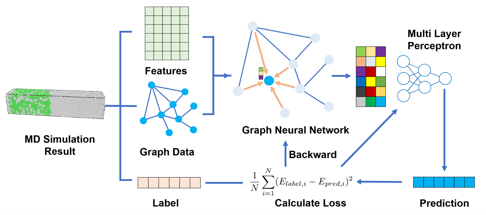
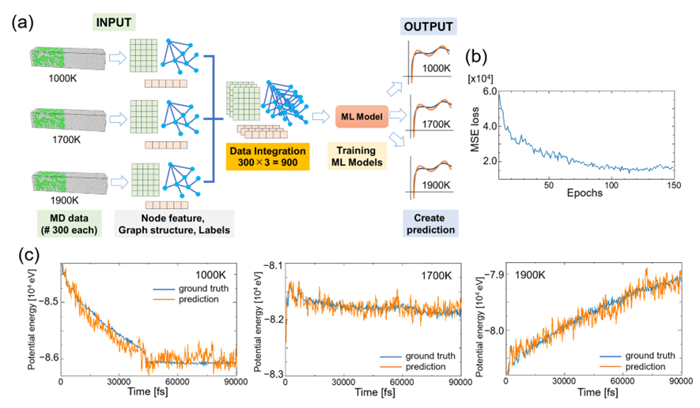

# MD-GNN

[](https://doi.org/10.1016/j.commatsci.2023.112448)
[](LICENSE)

Official implementation of **"Prediction of potential energy profiles of molecular dynamic simulation by graph convolutional networks"** (Kota Noda and Yasushi Shibuta, *Computational Materials Science* **229** 112448, 2023).

MD-GNN converts each snapshot of a molecular dynamics (MD) simulation into a graph and predicts its physical properties, such as the potential energy, with a graph convolutional network (GCN).

<p align="center"></p>

<p align="center"></p>

> **Follow-up work:** [MD-GNN TimeSeries](https://github.com/nodematerial/MD-GNN_TimeSeries) extends this model with an LSTM to predict long-term trends of physical properties from only the first 20 snapshots of an MD simulation ([J. Phys.: Condens. Matter 36 385902, 2024](https://doi.org/10.1088/1361-648X/ad5821)).

## Table of contents

- [Requirements](#requirements)
- [Setup](#setup)
- [Usage](#usage)
  - [Step 1. Run the MD simulation](#step-1-run-the-md-simulation)
  - [Step 2. Build graph representations](#step-2-build-graph-representations)
  - [Step 3. Prepare labels and CNA](#step-3-prepare-labels-and-cna)
  - [Step 4. Train the model](#step-4-train-the-model)
  - [Step 5. Predict the potential energy](#step-5-predict-the-potential-energy)
- [Configuration](#configuration)
- [Repository structure](#repository-structure)
- [Citation](#citation)
- [Contact](#contact)

## Requirements

- NVIDIA GPU with CUDA support
- Docker with [NVIDIA Container Toolkit](https://docs.nvidia.com/datacenter/cloud-native/container-toolkit/latest/install-guide.html)

The Docker image includes CUDA 11.7, [LAMMPS](https://www.lammps.org/) built with the GPU and MANYBODY packages, PyTorch 2.0.1, PyTorch Geometric, and OVITO. Python dependencies are installed with Poetry during the build.

## Setup

```bash
git clone https://github.com/nodematerial/MD-GNN.git
cd MD-GNN
docker compose up -d --build
docker compose exec app bash
```

## Usage

Steps 1–3 generate the dataset for one temperature. Each file in `configs/` corresponds to one temperature (`config1.yml` = 1000 K, …, `config10.yml` = 1900 K).

To run steps 1–3 at once:

```bash
make all CONF_NAME=config1.yml
```

### Step 1. Run the MD simulation

```bash
make lmp CONF_NAME=config1.yml
```

This runs LAMMPS with the input file given by `lmpfile_name` in the directory `lmpfile/<dirname>`. Snapshots are written to `dumpfiles/<dirname>/`.

The provided inputs simulate a Ni solid–liquid coexisting system for 90 ps. `lmpfile/Ni` writes a snapshot every 300 fs, and `lmpfile/Ni_600fs` and `lmpfile/Ni_900fs` write one every 600 fs and 900 fs. To write your own input, see the [LAMMPS documentation](https://docs.lammps.org/Manual.html).

### Step 2. Build graph representations

```bash
make makegraph CONF_NAME=config1.yml
```

Each atom becomes a node, and an edge is created between two atoms closer than `cutoff` (Å). Node features and edges are written to `dataset/<dirname>/<cutoff>/`.

### Step 3. Prepare labels and CNA

```bash
make cna CONF_NAME=config1.yml     # Labels each atom as solid or liquid by common neighbor analysis
make thermo CONF_NAME=config1.yml  # Converts the LAMMPS log into dataset/<dirname>/thermo.csv
```

`make remove CONF_NAME=config1.yml` deletes the generated dump files and dataset for that config.

### Step 4. Train the model

Move to an experiment directory under `script/` and run:

```bash
cd script/latest
poetry run python3 train.py
```

The training settings are read from `config.yml` in the same directory.

### Step 5. Predict the potential energy

```bash
poetry run python3 infer.py    # Writes prediction.csv
poetry run python3 mapping.py  # Plots the prediction against MD into images/
```

## Configuration

### Dataset generation (`configs/*.yml`)

```yml
lmpfile_name: in.ni_sl     # LAMMPS input file name
dirname: Ni/1000K          # Directory under lmpfile/, also used for dumpfiles/ and dataset/
cutoff: 2.7                # Threshold distance (Å) for creating an edge between two atoms
time: [0, 90000, 300]      # [first step, last step, interval] in fs, or a single time
division: [10, 10, 10]     # Number of cells along x, y and z used to search neighbors
```

`configs/` covers only `lmpfile/Ni`. To use `Ni_600fs` or `Ni_900fs`, copy a config and change `dirname` and the interval in `time`.

### Training (`script/*/config.yml`)

```yml
cutoff: 2.7                # Must match the cutoff used in step 2
interval: 300              # Snapshot interval in fs
data_per_condition: 300    # Number of snapshots per temperature
train_dirs: [Ni/1000K, ...]  # Temperatures used for training
valid_dirs: [Ni/1100K, ...]  # Temperatures used for validation
all_dirs: [Ni/1000K, ...]    # train_dirs + valid_dirs

seed: 42
hidden_channels: 20        # Hidden dimension of the GCN layers
epochs: 180
lr: 1.0e-3

wandb: true                # Logs to Weights & Biases. Set to false if you do not use it
project_name: MDGNN
exp_name: Experiment3

BASE_ENERGY: -86038.465    # Potential energy at the first step
```

The provided configs set `wandb: true`. Set it to `false` unless you are logged in to [Weights & Biases](https://wandb.ai/).

## Repository structure

```
.
├── configs/            # Per-temperature settings for dataset generation
├── lmpfile/            # LAMMPS inputs and the Ni EAM potential (Purja Pun & Mishin 2009)
│   ├── Ni/             # Snapshot every 300 fs
│   ├── Ni_600fs/       # Snapshot every 600 fs
│   └── Ni_900fs/       # Snapshot every 900 fs
├── script/
│   ├── makegraph.py    # Atom coordinates -> graph
│   ├── cna.py          # Common neighbor analysis
│   ├── log_process.py  # LAMMPS log -> CSV
│   ├── exp1/           # Training on a single temperature (1000, 1700, 1900 K)
│   ├── exp2/           # Training on 1000, 1700 and 1900 K together
│   ├── exp3/           # Training on 4 temperatures, validation on the other 6
│   ├── exp4_600fs/     # Same as exp3 with snapshots every 600 fs
│   ├── exp4_900fs/     # Same as exp3 with snapshots every 900 fs
│   └── latest/         # Same setting as exp3
├── shell_script/       # Called by the makefile
├── Dockerfile
└── compose.yml
```

The following directories are created when you run the steps above.

- `dumpfiles/`: snapshots from LAMMPS
- `dataset/`: graphs, CNA labels and potential energy

## Citation

```bibtex
@article{Noda2023,
  title    = {Prediction of potential energy profiles of molecular dynamic simulation by graph convolutional networks},
  author   = {Noda, Kota and Shibuta, Yasushi},
  journal  = {Computational Materials Science},
  volume   = {229},
  pages    = {112448},
  year     = {2023},
  doi      = {10.1016/j.commatsci.2023.112448},
  keywords = {Molecular dynamics, Machine learning, Graph convolutional networks, Graph representation, Solid-liquid coexisting system}
}
```

## Contact

If you have any trouble, please open an issue.

## License

[Apache License 2.0](LICENSE)
